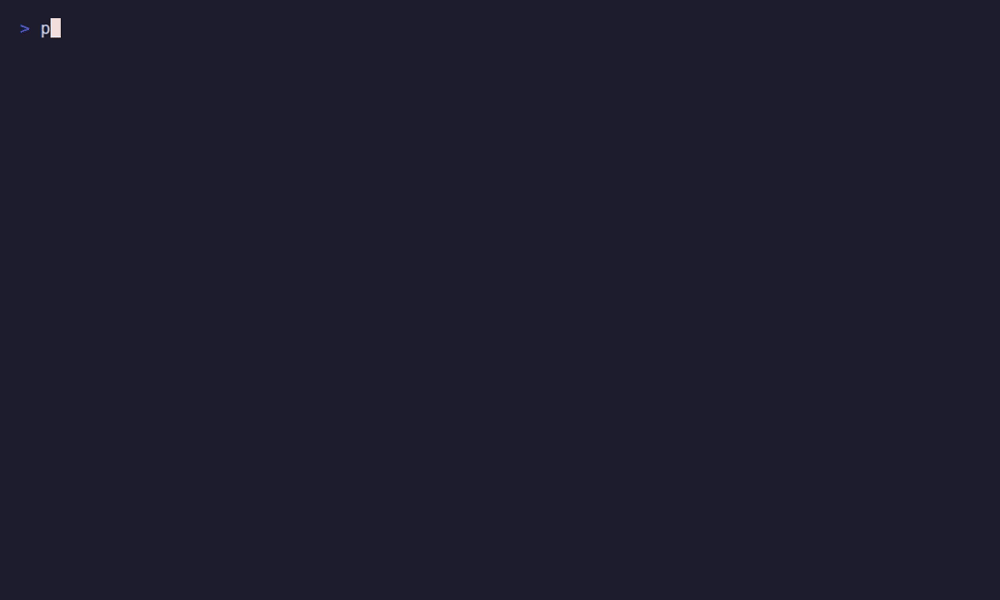

[简体中文](./README.md) · [Website](https://promptshield.lei6393.com) · [GitHub](https://github.com/SuperMarioYL/promptshield)

<picture>
  <source media="(max-width: 600px) and (prefers-color-scheme: dark)" srcset="./assets/presentation/hero-mobile-dark.svg">
  <source media="(max-width: 600px)" srcset="./assets/presentation/hero-mobile-light.svg">
  <source media="(prefers-color-scheme: dark)" srcset="./assets/presentation/hero-dark.svg">
  
</picture>

# PromptShield

**Find suspicious instructions in repository text**

PromptShield scans the text a coding agent may read, highlights prompt-injection patterns with source locations, and returns a CI failure when HIGH findings remain.

## Why use it

Comments, documentation and commit messages can contain instructions addressed to an agent. Reviewing those surfaces separately from executable behavior helps identify suspicious directions before they enter the agent’s context.

- **Locate the instruction** — Findings retain file, line, surface, rule and rationale.
- **Include decoded text** — The optional decode pass adds base64, hex and Unicode-normalized variants.
- **Fit repository review** — Scan a path, added diff lines with commit messages, or saved GitHub PR-files JSON.

## Architecture

<picture>
  <source media="(max-width: 600px) and (prefers-color-scheme: dark)" srcset="./assets/presentation/architecture-mobile-dark.svg">
  <source media="(max-width: 600px)" srcset="./assets/presentation/architecture-mobile-light.svg">
  <source media="(prefers-color-scheme: dark)" srcset="./assets/presentation/architecture-dark.svg">
  
</picture>

Collectors identify supported comment, document and change surfaces. The decoder creates additional variants without losing source attribution. YAML rules classify matches, scanner.py deduplicates and sorts findings, and the baseline suppresses accepted fingerprints. Table, JSON and SARIF outputs share one ScanResult.

| Component | Responsibility |
| --- | --- |
| `Collectors` | paths / diffs / PR JSON |
| `Decode + rules` | text variants and patterns |
| `Baseline` | accepted finding fingerprints |
| `ScanResult` | evidence, counts and exit code |

## Install and quickstart

Python 3.12+ and uv. Local fixture scans require no model or network.

```bash
git clone https://github.com/SuperMarioYL/promptshield.git
cd promptshield
uv venv --python 3.12
source .venv/bin/activate
uv pip install -e .
```

The script runs the real CLI over the shipped clean.py and utils.py fixtures, summarizes their JSON results, and checks the expected 0/1 exit codes. The suspicious file is only read as text.

```bash
.venv/bin/python examples/presentation_demo.py
```

## Recorded demo

<picture>
  <source media="(max-width: 600px) and (prefers-color-scheme: dark)" srcset="./assets/presentation/process-mobile-dark.svg">
  <source media="(max-width: 600px)" srcset="./assets/presentation/process-mobile-light.svg">
  <source media="(prefers-color-scheme: dark)" srcset="./assets/presentation/process-dark.svg">
  
</picture>

The clean fixture exits 0; the injection fixture exits 1. Neither fixture is executed.

```text
{"fixture": "clean.py", "exit_code": 0, "counts": {"HIGH": 0, "MED": 0, "LOW": 0}, "rule_ids": []}
{"fixture": "utils.py", "exit_code": 1, "counts": {"HIGH": 4, "MED": 0, "LOW": 0}, "rule_ids": ["PS001-instruction-override-direct", "PS010-destructive-shell", "PS011-destructive-instruction", "PS020-exfil-secrets"]}
Scope: deterministic static fixture scan; no fixture code executed and no model called.
```

The complete command and output are recorded in [docs/demo-results.json](./docs/demo-results.json). Inputs and reproduction code are included in the repository.



The existing recording is retained for context; the text example above documents the reproducible scenario.

## Usage

The first example intentionally returns 1. --diff requires a valid Git reference in the selected repository. --pr accepts a saved PR-files JSON document; it does not fetch one automatically. Use --format sarif for CI ingestion or --format json for scripts. --diff and --pr are mutually exclusive.

```bash
.venv/bin/promptshield scan ./tests/fixtures/malicious_pr --format json
.venv/bin/promptshield scan --diff HEAD~1 --repo . --format sarif
.venv/bin/promptshield rules list
```

## Configuration

Repeat --rules with YAML files or directories to stack rule packs; later same-ID rules override earlier ones. --baseline selects an accepted-findings file, default .promptshield-baseline.yaml. --update-baseline writes all current findings and exits 0, so use it only after reviewing the findings. --no-decode disables decoding and --no-color disables terminal color. HIGH findings exit 1; MED and LOW findings alone do not.

## Integrations and responsibilities

<picture>
  <source media="(max-width: 600px) and (prefers-color-scheme: dark)" srcset="./assets/presentation/integrations-mobile-dark.svg">
  <source media="(max-width: 600px)" srcset="./assets/presentation/integrations-mobile-light.svg">
  <source media="(prefers-color-scheme: dark)" srcset="./assets/presentation/integrations-dark.svg">
  
</picture>

PromptShield reports textual patterns. A runtime must still enforce its own trust boundaries, and reviewers decide whether a flagged instruction is legitimate documentation or an attack. Rule packs and baselines let that review remain explicit.

| Route | Implemented role |
| --- | --- |
| Repository paths | comments and document surfaces |
| Git diff | added lines and commit messages |
| PR-files JSON | saved GitHub API input |
| Rule packs | stacked YAML rules |
| SARIF / JSON | CI and review tools |

## Limits and next steps

- Pattern matching can miss novel attacks or flag legitimate examples. No findings is not a proof that text is safe for an agent.
- Decoding covers implemented transformations, not arbitrary obfuscation or model behavior.
- The demo verifies fixture detection, not whether a model follows or ignores injected instructions.

Implemented: repository/diff/PR scans, decoded variants, stacked rules, baseline handling and SARIF. Further work can expand language collectors and evaluate false positives on representative repositories. Runtime interception and a hosted review service are outside this CLI.

## License and contributions

See [LICENSE](./LICENSE). When reporting an issue, include a minimal input, the command, and the observed output.
